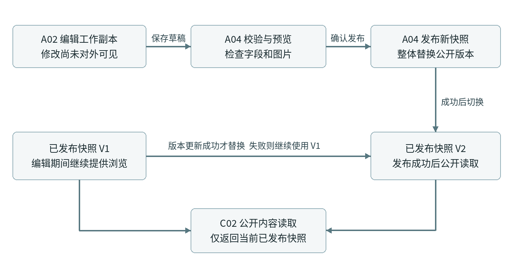

# 作品展示网站模块需求说明

版本 0.2 · 2026-10-25。本文由同目录 Word 文档转为 Markdown，便于仓库检索与评审。原始版式见 [PDF](作品展示网站前期设计与分析.pdf)；最新布局、尺寸与交互说明见 [V1.1 设计交付说明](../design-handoff-v1.1.md)。

页面职责  功能规则  数据状态  验收条件

版本 0.2    2026 年 10 月 25 日    用于需求与设计评审

### 本版结论

保持上一版的作品展示网站方向，采用 8 个页面模板作为细化基线：4 个对外页面、3 个管理页面和 1 个管理登录页。首页仍包含 9 个内容区块。将这些页面进一步拆成 24 个功能模块，使设计人员知道要画哪些状态，开发人员知道功能边界，验收人员知道如何判断完成。

### 本次增加的开发粒度

| 上一版已有 | 本版补齐 |
| --- | --- |
| 页面与首页区块 | 页面承载模块；模块输入、操作、输出与边界 |
| 动画效果说明 | 触发、起止状态、移动端替代与关闭动画规则 |
| 作品上传想法 | 上传校验、重试、封面裁剪、引用与删除规则 |
| 草稿与发布 | 工作副本、已发布快照、更新失败和下架传播 |
| 设计检查清单 | 模块验收编号、跨模块用例、依赖与交付次序 |

### 设计基线与范围

- 面向访客展示作品，面向一个维护者管理内容；访客不需要注册。

- 本版默认中文、图片作品优先。短视频作为可选扩展，视频上传与播放未计入首期必做项；若作品以视频为主，应在功能评审时调整。

- 首版交付包含可用的浏览与发布闭环，以及对照视频完成的核心视觉动效；装饰动画不阻塞任何操作。

- 继续按“需求评审 → Figma（界面设计工具）设计 → 设计评审 → 开发”推进。本轮产出需求说明。

本文数量上限、字段长度与动画参数是建议的执行基线，可在评审时整体调整；品牌文案和真实作品暂用明确编号的占位内容。技术框架、身份提供方和存储供应商留给后续技术方案选择。

## 一 页面与模块对应关系

页面是访问入口，模块是可独立说明职责并验收的功能。一个页面可以包含多个模块；一个模块也可以被多个页面复用。分类、上传和发布无需因此新增独立页面。

| 页面 | 模块归属 | 主要出口 |
| --- | --- | --- |
| 首页 / | H01–H09；复用 G01、G02 | 作品列表、详情、关于联系 |
| 作品列表 /works | W01；复用 G01、G02 | 作品详情；返回保留筛选 |
| 作品详情 /works/:slug | W02；复用 G01、G02 | 图片放大、相关作品、联系 |
| 关于联系 /about | W03；复用 G01 | 复制联系信息、打开外部链接 |
| 登录 /admin/login | A00 | 管理首页或原目标页面 |
| 作品管理 /admin/works | A01；调用 A04 | 编辑、发布、下架、排序 |
| 新建编辑 /admin/works/:id | A02、A03、A04 | 保存草稿、预览、发布 |
| 网站设置 /admin/settings | A05、A06 | 品牌、首页配置、分类维护 |

### 模块目录

| 分组 | 编号 | 职责 |
| --- | --- | --- |
| 全站复用 2 个 | G01–G02 | 导航页脚、作品卡片与放大层 |
| 首页展示 9 个 | H01–H09 | 首屏、精选、品牌视觉、主张、分类、画廊、故事、能力、联系 |
| 对外页面 3 个 | W01–W03 | 作品列表、详情、关于联系 |
| 后台维护 7 个 | A00–A06 | 身份、作品管理、编辑、上传、发布、设置、分类 |
| 公共能力 3 个 | C01–C03 | 媒体资源、公开内容读取、适配与状态处理 |

阅读顺序：先看页面关系和发布模型，再按模块查功能；字段字典、验收清单和 Figma 任务放在后半部分。每个模块均提供两个最小验收场景，跨模块场景另列。

## 二 内容流转与发布模型

作品只有一份业务身份，但可以同时有“编辑中的工作副本”和“已发布的公开快照”。首页、列表和详情读取同一公开版本，编辑器读取工作副本。这样修改草稿不会污染线上内容。

图 1  发布成功前保留旧版本  失败不切换公开内容

| 事件 | 工作副本 | 访客看到的内容 |
| --- | --- | --- |
| 新建并保存 | 产生草稿 | 不显示 |
| 首次发布成功 | 保留为后续编辑起点 | 出现发布快照 V1 |
| 编辑已发布作品并保存 | 产生未发布修改 | 继续显示 V1 |
| 再次发布成功 | 与新快照一致 | 统一切换到 V2 |
| 下架 | 保留内容与引用记录 | 从公开入口移除；直达详情不可见 |

公开作品条件统一为“有有效发布快照且未下架”。不只是在前端隐藏按钮，公开读取本身也必须执行相同规则。下架后，新发起的公开读取应立即排除该作品；已打开页面无法收回已经显示的图片，但再次打开详情必须校验可见性。

## 三 H01 首屏作品展开

### H01 首屏与作品卡片展开

作用与边界：让访客在第一屏知道品牌做什么，并通过作品进入浏览。只承担第一印象和导流，不在首屏提供编辑或交易功能。

功能：展示标志、主标题、补充说明、浏览作品按钮和最多 8 张作品卡片；维护者在 A05 选择作品和顺序；点击卡片进入该作品详情，主按钮进入列表。

规则与数据：数据为首页草稿或已发布配置中的标题、说明和作品编号；公开展示只解析已发布作品。桌面有 4–8 张时使用展开构图，1–3 张使用稀疏构图，0 张时只展示品牌与浏览入口。手机最多展示前 5 张。

状态与异常：标题和按钮先出现；图片逐张加载不阻挡其他卡片。封面失效时显示作品标题和中性占位；作品失效时跳过，不生成空链接。

依赖与交付：G02 作品卡片、A05 首页配置、C02 可见性过滤；设计需提交聚拢与展开两帧；优先级：P0 功能闭环与 P1 核心动效。

验收 H01 AC1：配置 8 个作品，其中 2 个为草稿：访客仅看到 6 个已发布作品，按配置顺序排列。

验收 H01 AC2：开启减少动画后，标题、按钮和全部有效作品仍可点击；卡片不等待展开才允许访问。

### 动画执行基线

| 阶段 | 触发与建议基线 | 可操作性 |
| --- | --- | --- |
| 进入 | 当前页面首次显示后，卡片依次展开；建议总时长约 0.8–1.2 秒 | 文字与主按钮始终可用 |
| 阅读 | 完成进入后维持稳定构图；悬停或聚焦突出当前卡片 | 点击卡片进入详情 |
| 离开 | 首屏由上向外滚动时，按区块进度轻微收束并退出 | 不劫持滚轮，不强制停留 |
| 返回 | 从详情返回时直接恢复稳定展开态 | 恢复原滚动位置，不重播遮挡动画 |

重叠卡片的可点击区域必须与可见部分一致。聚焦卡片移到前层，其他卡片不因装饰层遮挡而无法操作。最终位移、倾角和速度由 Figma 动画标注确认。

## 四 H02 精选作品与 H03 品牌视觉

### H02 阶梯式精选作品

作用与边界：用少量代表项目说明作品质量；与 H01 的品牌印象不同，这里给出作品标题和项目类别。

功能：左侧展示区块标题与简介，右侧展示 3–5 张阶梯卡片；点击单项进入详情，“全部作品”进入列表。

规则与数据：由 A05 手动选择最多 5 个作品并排序；不自动拿其他作品补位；有效项少于 3 个改为普通卡片排列，0 个隐藏本区块。

状态与异常：进入视口后按滚动进度重排，稳定展示时才允许悬停抬升；减少动画时直接静态排列；图片失败按 G02 处理。

依赖与交付：A05 精选顺序、G02 卡片、C03 动画降级；优先级：P0 展示与 P1 重排动效。

验收 H02 AC1：选择 5 项后下架其中 1 项：公开区块显示 4 项，其余顺序不变。

验收 H02 AC2：只有 2 个有效精选时使用两卡布局，标题和卡片不出现空位。

### H03 品牌横幅与合作标志

作用与边界：提供沉浸式品牌视觉与可信背景，不把合作标志当作必须的装饰。

功能：显示横向主视觉，可绑定一个作品详情；下方显示最多 12 个合作标志，标志可附外部链接。

规则与数据：主视觉由 A05 上传或选择资源，并保存桌面和手机裁剪焦点；关联作品失效后取消跳转，仍可显示独立品牌图；标志没有链接时不显示可点击样式。

状态与异常：主视觉缺失则隐藏横幅；只有标志时可单独显示标志行。手机换行显示标志，不缩小到无法辨认；视频主视觉留到视频范围确认后再扩展。

依赖与交付：A03 上传、A05 品牌配置、C01 裁剪衍生资源；优先级：首版。

验收 H03 AC1：上传横图并设置手机焦点：手机裁剪保留指定主体，详情原图不被覆盖。

验收 H03 AC2：合作标志无链接时不出现手型或空跳转；所有标志为空时不占空白区域。

## 五 H04 品牌主张与 H05 分类入口

### H04 逐步显现的品牌主张

作用与边界：让访客在作品之间理解品牌定位。移动作品图属于装饰，不能遮挡正文。

功能：展示一段最多 120 字的文字、可选关于入口和最多 3 张浮动作品图；随滚动逐句强调。

规则与数据：正文从首页配置读取，内容按自然句组织；视觉强调不拆坏中文断句；所有文字始终保留在可访问文本中。装饰图可引用作品，但不是唯一的作品访问入口。

状态与异常：正常状态从低强调到黑色强调；减少动画时全部黑色静态显示。无正文则隐藏整个区块；无装饰图保留文字。

依赖与交付：A05 文案配置、C03 滚动与可访问性；优先级：P0 文案与 P1 逐句强调。

验收 H04 AC1：关闭动画后能一次读到整段内容，不存在透明文字或无法显示的句子。

验收 H04 AC2：未上传装饰图时文字正常居中，“了解我们”仍进入关于页。

### H05 文件夹式作品分类

作用与边界：让访客按作品类型找到方向；这里只做分类预览，完整结果在作品列表。

功能：显示最多 4 个分类标签，点击切换最多 6 个作品预览；“查看该分类”进入带分类条件的作品列表。

规则与数据：分类来自 A06，顺序由首页配置指定。首次选中第一个有公开作品的有效分类；单一分类时隐藏切换标签。每个分类按公开作品全局顺序取前 6 项。

状态与异常：切换时短暂保留容器高度以减少跳动；快速连续选择只采用最后选择结果；分类没有公开作品时显示说明与全部作品入口。所有分类失效则隐藏区块。

依赖与交付：A06 分类、W01 筛选、C02 公开作品列表；优先级：首版。

验收 H05 AC1：先点分类甲再立即点乙：最终仅乙处于选中态，预览和跳转地址均对应乙。

验收 H05 AC2：从分类预览进入列表：列表使用相同分类条件，数量按全部公开作品计算。

## 六 H06 画廊与 H07 案例故事

### H06 双排作品画廊

作用与边界：用较多作品形成整体风格印象，不承载完整分类与查找功能。

功能：展示最多 16 个选择的作品，桌面两排缓慢横移；提供暂停与继续；悬停、键盘聚焦或页面不可见时暂停；卡片可进入详情。

规则与数据：后台只选择业务作品一次；动画需要的视觉副本不计为新作品，不加入键盘焦点序列。少于 6 项时改为静态画廊；0 项隐藏。

状态与异常：手机优先手动横滑；横滑时松手不误触作品链接；减少动画时停止自动运动，保留浏览与点击。离开视口后不继续运行无用动画。

依赖与交付：G02 卡片、A05 作品集合、C03 暂停与减弱动画；优先级：P1 展示增强  首版高保真阶段交付。

验收 H06 AC1：点击暂停后等待至少 3 秒：卡片位置不继续移动；继续后再移动。

验收 H06 AC2：键盘依次访问作品时，每个真实作品只进入焦点一次；减少动画模式不自动滚动。

### H07 案例故事入口

作用与边界：把图片吸引力转换为项目理解，展示项目目标或成果；不新增一个新闻文章系统。

功能：展示 2–3 个代表案例的封面、作品标题、短摘要和详情入口；只有 1 项时采用单卡布局。

规则与数据：案例选择引用作品编号，标题与摘要来自作品发布快照；允许在 A05 为首页设置不超过 80 字的入口摘要，留空则使用作品摘要。

状态与异常：没有有效案例则隐藏；作品下架后自动移除入口；摘要缺失时只显示标题，不生成虚构成果或重复模板文案。

依赖与交付：A05 案例选择、A04 快照、W02 详情；优先级：首版。

验收 H07 AC1：修改作品草稿摘要而不发布：访客案例卡片仍显示已发布摘要。

验收 H07 AC2：案例下架后，首页无死链；其余案例按配置顺序展示。

## 七 H08 能力介绍与 H09 联系收尾

### H08 服务或能力介绍

作用与边界：向潜在客户说明可以提供什么服务，替代参考视频中的会员价格；首期没有下单或收费流程。

功能：最多 3 张能力卡片，每项有标题、说明和可选联系按钮；按钮到关于页的联系区。

规则与数据：标题最多 20 字，说明最多 100 字；按 A05 配置顺序展示。单项标题或说明缺失时不允许发布启用状态的该项。无有效项则隐藏区块。

状态与异常：卡片可轻微悬停抬升，但不出现购买、订阅或付款成功状态；手机按单列依次阅读。

依赖与交付：A05 网站内容配置、W03 联系入口；优先级：首版。

验收 H08 AC1：填写 3 项能力并发布配置：首页显示 3 项且顺序一致，按钮均进入联系区。

验收 H08 AC2：清空能力标题后发布：后台明确指出缺失项，线上仍保留旧配置。

### H09 联系收尾与装饰横幅

作用与边界：在浏览结束时给出清晰下一步；装饰横幅不影响联系信息和导航。

功能：展示收尾标题、浏览作品与联系品牌两个入口、可选荧光横幅和最多 8 个装饰图标；邮箱可直接复制。

规则与数据：联系方式从 W03 共用品牌数据读取，不在首页维护第二份。邮箱与社交链接都为空时，联系入口改为“了解品牌”并进入关于页，不显示失效复制按钮。

状态与异常：浮动图标仅在横幅边界内移动，不拦截按钮点击；手机静态显示；复制失败时选中可复制文字并给出提示，不声称已发送消息。

依赖与交付：G01 页脚、W03 品牌联系、C03 动画边界；优先级：P0 联系与 P1 装饰效果。

验收 H09 AC1：复制邮箱后显示复制结果，页面不跳转；关闭复制权限时显示可手动复制的邮箱。

验收 H09 AC2：没有联系方式时仍有可用的作品入口，且不存在空链接、空二维码或无法操作的按钮。

## 八 G01 与 G02 全站复用模块

### G01 导航与页脚

作用与边界：统一网站入口、当前位置和品牌联系信息，避免每页各写一份。

功能：标志回首页；作品进入列表；关于进入关于页；联系进入关于页联系区。手机菜单支持打开、关闭与选择后关闭；页脚展示已配置的信息。

规则与数据：当前页菜单有选中态；没有配置的外部入口不显示。外部链接仅使用已校验的完整地址，默认新窗口打开并标识外链。

状态与异常：菜单或图片弹层打开时锁定背景滚动，关闭后恢复；按退出键关闭，焦点回到触发按钮；导航保持在装饰层之上。

依赖与交付：A05 品牌数据、C03 焦点与滚动恢复；优先级：首版。

验收 G01 AC1：从手机菜单点击作品：进入列表并关闭菜单，背景恢复可滚动。

验收 G01 AC2：键盘打开菜单再按退出键：菜单关闭，焦点回到菜单按钮。

### G02 作品卡片与图片放大层

作用与边界：封装各页面共同的作品展示和图片浏览行为，保证点击结果与异常处理一致。

功能：卡片展示封面、标题和按场景选择的分类年份；详情图放大层支持上一张、下一张、关闭与键盘左右切换。

规则与数据：卡片只接受公开作品引用或已授权的预览数据。封面可裁剪，详情图与放大图按原比例完整显示；放大层不默认循环，首末张禁用相应方向。

状态与异常：加载时保留尺寸；失败时保留标题与重试入口。关闭弹层回到原图片位置，菜单和图片放大层不同时打开。

依赖与交付：C01 图像资源、W02 图片顺序、C03 弹层互斥；优先级：首版。

验收 G02 AC1：作品有 3 张详情图：打开第 1 张后上一张不可用；切换到第 3 张后下一张不可用。

验收 G02 AC2：封面请求失败：作品标题和详情链接仍可访问，不出现零高度卡片。

## 九 W01 作品列表与分类筛选

### W01 作品列表与浏览上下文

作用与边界：承载所有公开作品的查找与连续浏览，首页只负责精选和导流。首期按分类筛选，不增加全文搜索、复杂标签交叉筛选或推荐算法。

功能：展示标题、分类栏、公开作品总数与作品网格；每批 12 项，使用“加载更多”；点击作品进入详情；返回时恢复分类、已加载批次和滚动位置。

规则与数据：分类条件写入地址查询项 category；默认全部。作品按全局顺序与固定编号排序。首次加载固定该次浏览的作品编号顺序，后续沿游标继续；切换分类或刷新重置集合，新作品与重排在重置后出现；下架仍即时过滤。

状态与异常：区分首次加载、继续加载、无结果、服务失败与全部加载完成。继续加载失败保留已显示作品并允许重试。无效分类参数回到全部并提示分类不可用。

依赖与交付：A06 分类、A01 排序、C02 分页与可见性、G02 卡片；优先级：首版。

验收 W01 AC1：有 25 个公开作品：首次 12 个，第二批 12 个，第三批 1 个；最后显示已全部加载，所有作品无重复。

验收 W01 AC2：在分类甲加载两批并进入详情，再返回：分类甲、24 个已加载项及位置恢复；直接打开列表则从第一批开始。

### 边界条件

- 分类数量按本次浏览集合中仍有效的公开作品计算，不受已加载批次影响。数量为 0 的分类仍可显示，以便解释空结果。

- 同一浏览集合无新增重排导致的重复或漏项；下架项从后续请求排除，继续向后补足每批最多 12 项。客户端按编号去重。

- 浏览上下文至少保留本次标签页会话；若分类删除、集合过期或用户主动刷新，则回到新集合起点并提示，不无限恢复失效位置。

### 设计需要提供

桌面三列、平板两列、手机一至两列；长标题换行规则；分类选中；首次加载与加载更多；空结果、错误重试与全部加载完成状态。

## 十 W02 作品详情与相关作品

### W02 固定模板的作品详情

作用与边界：展示一个项目的背景、过程和结果，支持图片观看和后续联系。作品数量增加只新增内容，不新增页面模板。

功能：显示标题、封面或主视觉、可选客户年份角色、摘要、按顺序排列的文字或图片内容块、相关作品与联系入口；详情图片可打开 G02 放大层。

规则与数据：通过唯一访问标识 slug 读取公开快照；不把后台作品编号或草稿内容暴露给公开读取。内容块首期只支持文字和单图，最多 30 块；相关作品手选最多 3 项，未手选时按同分类排序取 3 项并排除当前作品。

状态与异常：无快照、下架或不存在的访问标识统一返回不可见状态，不提示作品是否为草稿；可返回作品列表。图片加载失败保留图注并允许重试；无相关作品则隐藏该区。

依赖与交付：A02 内容块、A04 发布快照、G02 放大层、C02 公开读取；优先级：首版。

验收 W02 AC1：已发布作品保存了新标题草稿：公开详情仍显示旧标题，维护者预览显示新标题。

验收 W02 AC2：通过收藏地址访问已下架作品：不返回其详情字段；页面给出作品列表入口。

### 阅读与跳转规则

- 正文最大阅读宽度与图片最大宽度分别定义，避免长段文字铺满屏幕；图像按比例展示，不裁去作品中的文字。

- 返回列表优先恢复 W01 上下文；由首页直接进入时提供“全部作品”入口。

- 相关作品中出现下架项时按公开规则排除，再按同分类补足；不足 3 项按实际数量显示。

### 需要准备的内容

至少 3 个真实案例，覆盖短标题与长标题、1 张图与多张图、横竖图混排、可选字段为空等情况。设计阶段应使用这些内容验证模板，而不是每个案例单独设计一套布局。

## 十一 W03 关于与联系

### W03 品牌介绍与联系入口

作用与边界：为个人或公司补充身份、能力与联系方法；与 H09 共用联系数据。首期提供直接联系，不建立线索表单或消息发送系统。

功能：展示品牌名、简介、主图、可选团队或环境图、能力列表、邮箱和最多 5 个社交或业务链接；邮箱提供复制与打开邮箱两种明确操作。

规则与数据：个人与公司使用相同数据结构；未填写的客户、团队等字段隐藏。邮箱复制只复制地址；打开邮箱仅调起用户客户端，不报告邮件发送成功。所有联系方式为维护者主动填入的公开内容。

状态与异常：无邮箱时隐藏邮箱操作；链接无效时阻止发布；没有任何联系方式时仍展示品牌介绍和作品列表入口。打开外部应用失败时提供可见地址便于手动操作。

依赖与交付：A05 品牌设置、H08 能力数据、H09 联系收尾、G01 外链行为；优先级：首版。

验收 W03 AC1：网站设置修改邮箱但尚未发布：关于页与首页仍同时显示旧邮箱；发布后同时变更。

验收 W03 AC2：仅填写公司简介、无团队图：关于页连续排版，无空标题或保留高度的空图片区。

### 可编辑项与展示顺序

| 区域 | 可编辑内容 | 显示条件 |
| --- | --- | --- |
| 品牌概述 | 名称、主图、100–1000 字简介 | 品牌名必填；简介为空时不显示正文 |
| 能力介绍 | 最多 3 项标题与说明 | 仅展示完整的已发布条目 |
| 团队或环境 | 最多 6 张图片及图注 | 可选；没有图片时整区隐藏 |
| 联系信息 | 邮箱、社交链接、可选公开地址 | 至少一种联系方式为上线建议，非草稿保存门槛 |

联系区使用稳定的页面锚点，首页和导航均可直接定位。固定导航不得遮住锚点标题；手机到达时邮箱和主要联系按钮应在附近可见。

## 十二 A00 身份与 A01 作品管理

### A00 维护者访问控制

作用与边界：区分访客与唯一维护者；管理页面可登录不代表任意人拥有编辑权限。

功能：未登录进入管理页时转到登录入口并记录目标；登录成功后只允许维护者继续；支持退出。登录方法在技术方案中选择，不开放访客注册。

规则与数据：所有管理读取与写入均校验身份；预览同样需要维护者权限。会话失效时停止提交，不把草稿转换成公开地址。

状态与异常：区分未登录、无权限、会话失效和服务错误；保留当前页面未提交内容并提示重新登录，但不向其他账号展示。

依赖与交付：身份方案、A02 编辑状态、A04 受保护预览；优先级：首版。

验收 A00 AC1：未登录者直接请求保存或预览操作：拒绝且不更改数据。

验收 A00 AC2：非维护者即使已登录：无法读取草稿、上传图片或发布配置。

### A01 作品管理与全局排序

作用与边界：快速查找、维护与组织作品，不重复提供正文编辑器。

功能：按标题搜索、分类和发布状态筛选；每页 20 项；新建、进入编辑、下架与移至回收区；用上移下移或拖拽维护全局公开排序。

规则与数据：首期仅单项发布与下架。无搜索分类筛选时可进入排序模式，加载完整公开集合，支持拖拽和移动到指定名次，统一保存后退出到分页管理；不限制在当前 20 项内排序。草稿不参与排序，首页手选顺序单独维护。

状态与异常：保存排序前只本地预览；失败恢复服务器顺序并提示。回收只允许未公开作品；仍公开的作品需先下架。回收区支持恢复，首期不提供永久清空。

依赖与交付：A04 发布下架、A06 分类、C02 排序；回收区为当前页面标签；优先级：首版。

验收 A01 AC1：有 25 个公开作品，进入排序模式把第 25 项移到第 1 位并保存：公开列表刷新后该项为首项；搜索筛选时不可排序。

验收 A01 AC2：下架后移入回收区再恢复：回到未发布状态，旧公开详情不会自动恢复。

## 十三 A02 作品编辑器

### A02 作品基本信息与内容块编辑

作用与边界：集中编辑一个作品的工作副本。对外模板固定，维护者只编辑内容而非任意搭建页面。

功能：编辑标题、访问标识、分类、摘要、客户年份角色、封面、内容块与相关作品；内容块支持新增文字、新增单图、上下移动和移除；保存草稿、预览和发布由 A04 承担。

规则与数据：新建后分配稳定作品编号。标题可在草稿暂缺，但首次发布必须补齐。首次发布时锁定公开访问标识，此后首期不改路径；避免修改标题导致收藏链接失效。文字块只保留正文和换行，不接受可执行代码。

状态与异常：有未保存改动时离开需确认；保存成功显示时间和版本；保存失败保留当前输入。多标签页版本冲突时阻止覆盖，允许将当前输入复制或暂存后刷新加载最新版本。

依赖与交付：A03 图片、A04 保存发布、A06 分类、字段字典；优先级：首版。

验收 A02 AC1：已发布作品改标题并保存草稿：详情路径不变，公开标题不变，后台标记有未发布修改。

验收 A02 AC2：两个标签页从同版本编辑，甲先保存：乙保存时显示冲突，不能静默覆盖甲的数据。

### 内容块操作规则

| 操作 | 执行规则 | 错误反馈 |
| --- | --- | --- |
| 新增文字块 | 初始为空；可保存草稿，发布时不保留空块 | 超出长度时定位到该块 |
| 新增单图块 | 引用上传成功的资源，可填图注和替代文字 | 上传未完成时阻止正式发布 |
| 调整顺序 | 修改块顺序并标记未保存，预览采用当前顺序 | 保存失败保留本地顺序 |
| 移除图片块 | 解除工作副本引用，不立即物理删除资源 | 若公开快照仍引用，旧页面照常读取 |

必填校验与错误定位应同时覆盖按钮旁汇总提示和具体字段。保存期间禁用重复保存；发布期间禁止同时修改同一作品，以免用户不知道发布的是哪个版本。

## 十四 A03 上传与封面裁剪

### A03 图片上传与复用

作用与边界：把本地作品图变为可保存、可引用的资源。文件选择、上传成功、绑定作品和对外发布是四个不同阶段。

功能：支持点击选择和桌面拖入，多图队列、逐图进度、取消未完成上传、失败重试、图片排序、选择封面、封面裁剪和设置焦点；编辑器可复用该作品已上传资源。

规则与数据：首期接收 JPG、PNG、WebP；每张原图最多 20 MB，每次队列最多 10 张，每件作品最多绑定 30 张图片，含封面去重计数。服务端再次验证格式、大小与可解码性；建议长边至少 1600 像素，低分辨率只提醒。

状态与异常：单图状态为排队、上传中、成功或失败；失败重试不重传其他成功项。修改封面只更新裁剪数据和衍生资源，不覆盖原图；移除待用图片不等于删除已发布图片。

依赖与交付：C01 资源记录与衍生图、A02 图片绑定、A04 发布校验；优先级：首版。

验收 A03 AC1：一次上传 5 张，其中 1 张失败：另 4 张保持成功；只重试失败项，不生成重复绑定。

验收 A03 AC2：超过 20 MB 或伪装扩展名文件：明确拒绝；原有作品图片和工作副本不受影响。

### 裁剪与图片展示规则

| 场景 | 保存的数据 | 展示方式 |
| --- | --- | --- |
| 封面 | 资源编号、标准化裁剪矩形、主体焦点 | 默认 3:4；按版位派生显示 |
| 横幅 | 同一原图的桌面与手机独立焦点 | 按画面容器裁剪 |
| 详情与放大 | 原图比例、图注、替代文字 | 完整展示，不套封面裁剪 |
| 资源复用 | 引用相同资源编号 | 一处取消引用不影响其他有效引用 |

普通作品上传不接受矢量文件。品牌矢量标志若需支持，应在后续技术方案中单独定义校验；本版默认可上传透明 PNG 标志。未绑定的临时上传可由系统延后清理，具体保留期见资源规则。

## 十五 A04 保存预览发布与下架

### A04 内容生命周期

作用与边界：保证维护过程与对外内容有明确边界；不仅控制作品，也控制品牌与首页配置的发布。

功能：保存工作副本、生成维护者预览、校验并发布、更新已发布内容、下架和恢复到可编辑状态。预览不使用可公开访问的长期草稿链接。

规则与数据：预览与发布先保存未保存改动，保存失败不继续。单作品预览读取明确草稿版本；整站预览读取配置草稿，但作品引用仍读公开快照。发布校验后生成完整快照，同次操作重试只生效一次。作品与配置分别发布，各对象整体生效。

状态与异常：发布校验失败保留旧快照；发布超时先查询原操作结果，不能直接假定失败并重复产生新版本。下架优先禁止新公开读取；首页和相关作品自动过滤，不要求手工逐处清理。

依赖与交付：A00 权限、A02 工作副本、C01 资源就绪、C02 公共可见性；优先级：首版。

验收 A04 AC1：已发布 V1，保存新草稿后发布失败：列表、首页和详情全部继续读 V1，不出现半更新。

验收 A04 AC2：发布请求已成功但响应丢失：查询同一操作得到成功版本，不再次新增发布快照。

### 发布前的硬性校验

- 作品有标题、唯一访问标识、可保留或新选的合法分类、成功封面与至少一个非空内容块。停用分类可由原有关联作品继续保留，不允许新增关联。

- 所有发布引用图片均可用；空内容块清理后不能为空；相关作品只能引用其他有效公开作品。

- 首页已启用区块满足最低数据要求；关闭区块可保留不完整草稿。配置预览不把未发布作品当作公开作品。

- 修改基于当前版本；检测到并发版本变化时拒绝覆盖并提示刷新。

### 发布后的反馈

后台显示发布成功时间、公开状态和查看入口。作品发布仅更新该作品；首次发布不会自动加入首页手选集合。网站配置发布不会把被引用的草稿作品顺带发布，失效引用必须按可见性过滤。

## 十六 A05 网站设置与 A06 分类

### A05 品牌与首页配置

作用与边界：让维护者更换网站内容并控制首页区块，不提供任意拖拽建站或修改动画程序的能力。

功能：维护品牌、关于、联系、服务能力、横幅、合作标志、首页标题及各区块作品集合；开关可选区块；保存配置草稿、整站预览、发布配置。

规则与数据：H01、H02、H09 固定保留框架；H03–H08 可开关。首期首页区块顺序固定为 H01 至 H09，上一版“展示顺序”收敛为各区块内部作品顺序，降低动效与内容耦合。

状态与异常：后台提示失效作品引用；公开侧跳过，数据不足时按模块规则降级。发布失败时首页、关于页与页脚仍读同一旧配置快照。

依赖与交付：H01–H09、W03、A04 配置发布；品牌联系方式单一来源；优先级：首版。

验收 A05 AC1：修改邮箱并保存不发布：首页、关于页和页脚仍显示旧值；配置发布后同步切换。

验收 A05 AC2：关闭 H06 并发布：首页移除画廊及其占位高度，不影响作品列表。

### A06 分类字典维护

作用与边界：让首页分类和列表筛选使用同一分类定义；在网站设置中作为标签页，不增加独立页面。

功能：新建、改名、排序分类，查看公开作品与草稿引用数；停用或删除前检查引用。每个作品首期只选一个分类，未分类作品使用系统“其他”分类。

规则与数据：分类名 1–20 字，同站唯一，访问标识固定；改名排序保存即生效。删除检查工作副本、当前公开快照、当前首页配置和配置草稿，不含历史快照。旧快照保留分类名或删除标记用于审计，由技术方案实现。

状态与异常：停用禁止新关联，原有关联作品可保留该分类并重新发布；列表和旧链接可访问，原首页引用继续有效，但不可新增首页入口。彻底移除前迁移并发布全部有效引用。系统“其他”不可删除或停用。

依赖与交付：A02 单分类、W01 筛选、H05 标签；分类字典直接生效不走配置草稿；优先级：首版。

验收 A06 AC1：分类甲有 2 个草稿和 1 个公开作品：删除被阻止，并列出引用数和处理入口。

验收 A06 AC2：改名后列表与详情使用新分类名，访问条件仍使用原分类标识。

## 十七 C01 资源与 C02 公开内容

### C01 媒体资源与引用保护

作用与边界：让原图、封面衍生图、详情图与引用关系可追踪，避免改封面或删草稿导致线上断图。

功能：记录上传资源、原图尺寸格式、衍生图和使用位置；按版位返回适合尺寸；发布绑定不可变资源；清理从未发布且已无引用的临时资源。

规则与数据：只要当前公开快照或工作副本仍有引用，就不得物理删除。临时且无引用资源默认保留 7 天；进入回收区的作品资源先保留，首期不自动永久清理。已发布资源不因临时上传清理任务被删除。

状态与异常：生成封面失败只影响相关资源，提供重试并阻止引用该失败资源发布；访问不存在资源返回可处理的错误，前端使用中性占位。

依赖与交付：A03 上传、A04 引用快照、G02 尺寸占位；优先级：首版。

验收 C01 AC1：工作副本删除一张线上仍在用的图：公开详情继续加载该图；发布新快照前不能物理清理。

验收 C01 AC2：无引用临时图超过 7 天可被清理；仍被草稿引用的同龄图片不能被清理。

### C02 公开读取与一致性规则

作用与边界：统一首页、列表、详情、分类计数和相关推荐的可见性，不允许各页面自行判断草稿。

功能：按当前公开配置解析作品引用；支持分类、排序、分页；按访问标识读取详情；过滤下架与回收内容；按当前分类字典补充名称。

规则与数据：响应含版本标识。发布与下架成功反馈前完成公开版本切换；之后新请求读当前完整快照，下架作品不可读。缓存不得改变此语义。已打开页面可保持旧显示至刷新，同一作品不得拼装新旧字段。

状态与异常：服务失败保留已有成功渲染内容并允许重试；不把网络失败显示为“没有作品”。当前页面已持有的数据不能收回，但新请求仍重新校验。

依赖与交付：A04 生命周期、W01 分页、H01–H07 引用过滤；优先级：首版。

验收 C02 AC1：下架成功后分别刷新首页、列表和直达详情：三个入口均不再公开该作品。

验收 C02 AC2：作品更新时读取详情：只能得到 V1 或 V2 的完整快照，不得混合标题与图片版本。

## 十八 C03 适配动效与通用状态

### C03 跨页面体验规则

作用与边界：为全部展示模块提供一致的手机、键盘、动画降级和异常行为，避免每个区块单独发明处理方式。

功能：响应式布局、图片加载占位、可见焦点、弹层焦点管理、减少动画、暂停自动运动、错误与空状态、滚动位置恢复。

规则与数据：以 1440 与 390 像素画布设计，并检查 320–430 手机宽度；页面不得产生非画廊的横向溢出。菜单和放大层互斥。自动运动暂停状态由用户控制，减少动画模式关闭视差、自动横移与大范围重排。

状态与异常：区分加载、成功、真实为空、网络失败、内容不可见和权限不足；装饰或图片失败不导致文字与主按钮消失。动画功能不可用时采用静态稳定布局。

依赖与交付：所有公开页面与后台主要操作；组件状态在 Figma 中统一维护；优先级：首版。

验收 C03 AC1：以 320 像素宽查看四个公开页面：导航、标题和主按钮无水平溢出或遮挡。

验收 C03 AC2：启用减少动画并只用键盘：仍能完成作品筛选、进入详情、放大图片、关闭和联系。

### 统一反馈约定

| 状态 | 展示内容 | 用户可执行操作 |
| --- | --- | --- |
| 首次加载 | 稳定尺寸占位与简短提示 | 导航不失效 |
| 真实为空 | 说明原因，不伪造作品 | 查看全部或返回首页 |
| 读取失败 | 明确失败，不把数量当作 0 | 重试；保留已有结果 |
| 操作成功 | 显示对象与成功动作 | 查看结果或继续编辑 |
| 写入失败 | 保留输入，定位失败原因 | 重试或解决字段错误 |
| 内容不可见 | 不泄漏草稿存在性 | 返回作品列表 |

一般提示在操作附近出现；阻止发布的错误必须持续可见，不能只闪现一条短暂提示。图片替代文字描述作品内容，装饰图片从辅助阅读顺序中排除。

## 十九 作品数据字段与校验

以下定义是内容契约，不预先锁定数据库结构。长度按用户可见字符计数；可选字段缺失时前台隐藏其标签。草稿允许不完整，发布前执行硬性校验。

| 字段 | 约束与用途 | 何时必填 |
| --- | --- | --- |
| 作品编号 id | 系统生成且不可变；所有引用使用它 | 创建后必有 |
| 标题 title | 1–60 字；不允许仅空白 | 发布 |
| 访问标识 slug | 3–80 位小写字母数字与连字符；唯一，首次发布后固定 | 发布 |
| 分类 category_id | 一个有效分类；缺省系统其他 | 发布 |
| 摘要 summary | 0–200 字，用于列表或首页默认摘要 | 可选 |
| 客户 client | 0–60 字；个人项目可留空 | 可选 |
| 年份 year | 四位年份，1900–当前年后 1 年 | 填写时校验 |
| 角色 role | 0–100 字；说明参与职责 | 可选 |
| 封面 cover | 成功资源编号及裁剪焦点 | 发布 |
| 正文 blocks | 最多 30 块，清除空块后至少 1 块 | 发布 |
| 文字块 text | 每块 1–3000 字；保留换行，不执行代码 | 非空块 |
| 单图块 image | 资源编号、0–200 字图注、1–200 字替代文字 | 图与替代文字 |
| 相关作品 related_ids | 最多 3 个，不含自身，不可重复 | 可选 |
| 公开排序 order | 由 A01 管理，与首页顺序分开 | 公开作品 |
| 编辑版本 revision | 每次成功写入递增，用于冲突检测 | 系统维护 |

替代文字可默认以作品标题预填，维护者可补充画面说明。新建访问标识由标题建议生成，维护者可在首次发布前修改；不支持中文到英文的准确翻译承诺。

## 二十 分类资源与首页配置字段

| 对象 | 字段 | 规则 |
| --- | --- | --- |
| 分类 | 编号、名称、访问标识、顺序、启用状态 | 名称唯一；其他分类受系统保护；修改直接生效 |
| 资源 | 编号、原图地址、格式、宽高、大小、状态 | 只允许引用成功资源；原图不被裁剪覆盖 |
| 图片呈现 | 裁剪 x y 宽高、焦点 x y、替代文字 | 裁剪和焦点使用 0–1 标准化值，且在原图边界内 |
| 工作副本 | 对象编号、编辑版本、修改时间、内容 | 只供维护者读取；保存不等于发布 |
| 发布快照 | 对象编号、发布版本、发布时间、完整内容 | 生成后不修改；新发布创建新快照 |
| 发布操作 | 操作编号、对象、目标编辑版本、结果 | 同一操作重试返回同一结果 |

### 首页与品牌配置

| 配置组 | 字段与上限 | 消费模块 |
| --- | --- | --- |
| 品牌 | 品牌名 1–30 字、标志、简介、主图 | G01、W03 |
| 首屏 | 标题 1–40 字、说明 0–120 字、作品最多 8 项 | H01 |
| 精选与案例 | 精选最多 5 项；案例最多 3 项；各集合独立排序 | H02、H07 |
| 主张与分类 | 主张最多 120 字；分类最多 4 个 | H04、H05 |
| 画廊与视觉 | 作品最多 16 项；品牌横图；合作标志最多 12 个 | H03、H06 |
| 能力与联系 | 能力最多 3 项；邮箱；外链最多 5 个；收尾标题 | H08、H09、W03 |
| 区块开关 | H03–H08 各自启用或关闭；区块顺序固定 | 首页所有区块 |

同一集合内作品编号去重；不同区块可复用同一作品。公共邮箱为单一字段；外链只接受安全的完整网页地址，邮箱单独校验。所有启用区块的必填错误在网站设置中汇总并定位。

## 二十一 功能操作契约与关联影响

下表定义模块之间需要提供的业务操作，供后续技术设计映射成接口。没有在此锁定服务端路径或具体技术框架。所有写操作失败必须返回可识别原因，并保持原有公开数据不变。

| 操作 | 输入与前置条件 | 结果与失败边界 |
| --- | --- | --- |
| 保存作品草稿 | 维护者、对象、期望编辑版本、内容 | 新编辑版本；冲突时不覆盖 |
| 上传资源 | 维护者、文件、单次上传标识 | 资源编号与状态；失败不绑入作品 |
| 预览对象 | 维护者、已保存对象版本 | 受保护预览；未登录不得读取 |
| 发布作品或配置 | 维护者、已保存版本、发布操作标识 | 完整快照；重试幂等 即同次只生效一次 |
| 查询发布结果 | 维护者、原操作标识 | 处理中或终态；响应丢失后用于恢复 |
| 下架作品 | 维护者、作品编号、期望版本 | 公开入口失效；工作副本保留 |
| 查询公开列表 | 分类、每批数量、分页游标 | 当前公开作品集合及版本信息 |
| 读取公开详情 | 访问标识 | 完整公开快照或不可见 |
| 保存全局排序 | 完整公开作品顺序、期望排序版本 | 整体生效；冲突要求刷新 |
| 迁移分类引用 | 目标分类、选定作品集合 | 修改工作副本，公开引用需逐项发布才迁移 |

### 需要统一处理的关联事件

- 作品下架：H01、H02、H05、H06、H07、列表、相关推荐与直达详情一起执行可见性过滤。

- 更新封面：发布成功后引用新快照；旧图片资源保留到没有有效引用，不通过覆盖同一文件来更新。

- 分类改名：所有展示读取分类字典的新名称；分类删除必须先清理工作副本和公开快照的引用。

- 联系方式更新：发布品牌配置后，页脚、关于页与首页收尾读取同一配置版本。

## 二十二 内容生命周期与异常恢复

| 当前情况 | 允许动作 | 下一状态与公开结果 |
| --- | --- | --- |
| 新建草稿 | 保存、预览、发布、回收 | 保存后仍未公开；首次发布成功才公开 |
| 已发布且无改动 | 编辑、下架 | 编辑产生工作副本；原快照仍公开 |
| 已发布且有修改 | 保存、预览、发布修改、下架 | 只有发布成功才替换公开快照 |
| 发布处理中 | 查询结果 | 成功切换；失败保留旧版本；不能并发改写 |
| 已下架 | 编辑、预览、重新发布、回收 | 重新发布前仍不可见 |
| 回收区 | 恢复 | 恢复为未发布；不自动重新公开 |

### 四个异常场景必须能恢复

- 上传到一半断网：成功资源保留，未完成资源可重试；草稿中保留其他已保存内容。取消中的上传若晚到成功，也不能自动插入已取消队列。

- 保存成功但响应丢失：按对象最新编辑版本核对结果；重复保存必须携带预期版本，避免覆盖其他标签页改动。

- 发布成功但响应丢失：用原发布操作编号查询；未确认终态前不显示确定失败，也不生成另一次发布。

- 预览期间被下架：维护者仍可预览工作副本；访客新请求不可见。公开缓存与管理预览不能混用。

### 上线前的可恢复性要求

关键内容应有可恢复备份及操作记录，记录维护者、对象、动作、时间与版本，首期不额外开发日志页面。部署和备份方式由技术方案确定；上线前至少演练一次从已保存内容恢复网站，确认原图和内容引用可以对应。

作品详情的不可见提示、分类无结果和网络失败必须分开设计。一个请求失败不能把原本存在的作品集合误写成空集合或清空首页配置。

## 二十三 跨模块验收用例

以下用例覆盖模块组合后的真实使用路径。每个模块的两条验收编号位于相应章节；这些跨模块用例不能被单个按钮或静态截图验收替代。

| 编号与前置条件 | 操作 | 预期结果 |
| --- | --- | --- |
| E01 新建一个作品 | 上传封面与正文图，保存草稿 | 后台可预览；首页列表详情均不公开 |
| E02 E01 校验通过 | 发布并在首页配置选中后发布配置 | 列表与详情出现；首页点击到正确详情 |
| E03 作品已发布 | 改标题和图片，只保存不发布 | 公开入口仍保持旧完整版本 |
| E04 E03 有新草稿 | 发布修改时模拟失败 | 旧版本保持完整；草稿仍能继续编辑 |
| E05 作品被首页多处引用 | 下架后刷新所有公开入口 | 卡片与推荐排除；直达详情不可见 |
| E06 草稿和快照共用一张图 | 从工作副本移除图片 | 公开快照仍可读取图片，资源不被误删 |
| E07 两标签页编辑同版本 | 甲保存后，乙提交 | 乙收到冲突提示，甲内容不被覆盖 |
| E08 列表有 25 个作品 | 加载三批，进入详情再返回 | 12 加 12 加 1；不重复；返回恢复条件 |
| E09 已有品牌联系信息 | 修改保存后先预览再发布 | 预览新值；公开旧值；发布后各处同步 |
| E10 一个失败上传任务 | 重试该项并再次保存 | 只重试该项，无重复资源绑定 |
| E11 手机且减少动画 | 浏览筛选、详情、放大并联系 | 不依赖悬停或动画；全流程可完成 |
| E12 未登录或其他账号 | 访问草稿、管理写入、预览地址 | 全部拒绝；不泄漏草稿内容 |

验收数据至少覆盖 0、1、3、8、25 个作品，横竖图片、长标题、空可选字段、失效链接、图片加载失败和分类被停用。公开下架、编辑副本隔离和未授权拒绝属于发布阻断项。

## 二十四 开发工作包与依赖

这是用于估算和拆任务的工作包，不是当前开始开发的指令。后续每个任务必须关联模块编号、设计稿、输入输出和对应验收条件。

| 顺序与工作包 | 包含模块 | 依赖与完成标志 |
| --- | --- | --- |
| 1 内容与资源底座 | C01、A03、数据字段 | 资源可保存复用；原图与裁剪分离；单图失败可恢复 |
| 2 维护者与编辑 | A00、A01、A02、A06 | 可创建分类与作品草稿；访问控制与版本冲突可验证 |
| 3 发布与公开读取 | A04、C02 | 快照、下架、幂等查询与可见性闭环跑通 |
| 4 网站配置 | A05 | 品牌与首页集合可预览和发布；不把草稿作品带上线 |
| 5 全站与公开页面 | G01、G02、W01–W03、C03 | 真实数据完成筛选、详情、放大、返回与联系 |
| 6 首页基础展示 | H01–H09 的功能部分 | 9 区块可正确取数、隐藏、跳转，适应素材不足 |
| 7 核心视觉动效 | H01、H02、H04、H06、H09 | 按关键帧、手机与减少动画规则验收 |
| 8 集成与上线准备 | 全部模块与 E01–E12 | 权限、失败恢复、图片性能与备份验证通过 |

### 优先级定义

- P0：浏览、编辑上传、发布下架、权限、状态与恢复等闭环能力，是后续视觉调试的基础。

- P1：对照参考视频的首屏、重排、文字显现、画廊与装饰效果。它们属于首版高保真目标，不以完成静态页面代替。

- P2：视频上传、访客注册、交易订单、会员收费、多维护者审批、任意页面搭建、全文搜索与多语言；需求明确后另行拆分。

### 技术方案还需明确

身份接入方式、数据库与图片存储、图片衍生处理、公开缓存与下架失效策略、发布操作去重和查询机制、备份恢复及部署环境。技术选型应满足本文件的行为约束，不改变已确认的产品语义。

## 二十五 Figma 交付与需求评审

上一版 18 张页面或状态稿加 1 个组件区仅覆盖基础演示，本版应按需求状态补齐。页面模板仍为 8 个；空态、失败态、弹层和发布反馈不另计业务页面。

| 设计范围 | 必须覆盖的状态 | 关联模块 |
| --- | --- | --- |
| 四个公开页面 | 桌面与手机；真实作品长短内容；首屏聚拢展开 | G01–G02、H01–H09、W01–W03 |
| 列表与图片浏览 | 分类选中、加载更多、空结果、失败、放大首末张 | W01、W02、G02 |
| 管理与编辑 | 作品状态、字段错误、未保存离开、版本冲突 | A00–A02、A06 |
| 上传与裁剪 | 队列、进度、失败重试、焦点、移除确认 | A03、C01 |
| 发布与网站设置 | 草稿预览、发布校验、处理中、成功、失败、下架 | A04、A05、C02 |
| 全站组件与动效 | 默认聚焦禁用；动画起止、暂停与手机替代 | G01、G02、C03 |

### 每项设计标注的最低要求

- 对应模块与验收编号；区域尺寸、间距、文字与图片比例；可编辑字段和内容来源。

- 操作后去哪里、哪些状态变化、哪些请求失败要保留输入；不能只画成功状态。

- 动画开始与结束状态、触发、层级、暂停和减少动画；连续滚动另外附关键帧说明。

### 本轮评审需要确认的范围选择

- 是否接受图片优先、单维护者、中文的首期基线；如以视频为主，需重拆上传与播放模块。

- 是否接受首页区块固定顺序、区块内部作品可排序，以及分类单选。

- 是否接受作品发布与首页配置分别发布；是否存在必须多作品同时上线的需求。

- 品牌名称、联系方式、分类和真实案例内容可在结构设计后补齐，但至少用 3 个真实项目验证模板。

本版行为规则评审通过后，再制作 Figma 结构稿和高保真稿；设计状态覆盖本表后进行设计评审，再进入技术方案与开发。

## 附录 视频关键帧与视觉参考

沿用原方案中的参考视频画面。截图用于布局与动画状态定位；详细功能以本版模块规则为准，作品内容与品牌素材由你替换。

图 2  首屏卡片 阶梯排列 文字显现 文件夹分类 作品画廊与荧光收尾

首屏与作品详情的视觉组件应保持一致，但首页封面允许裁剪，详情图保持完整。后台使用清晰实用的表单和反馈，不复制展示首页的大幅动效。
