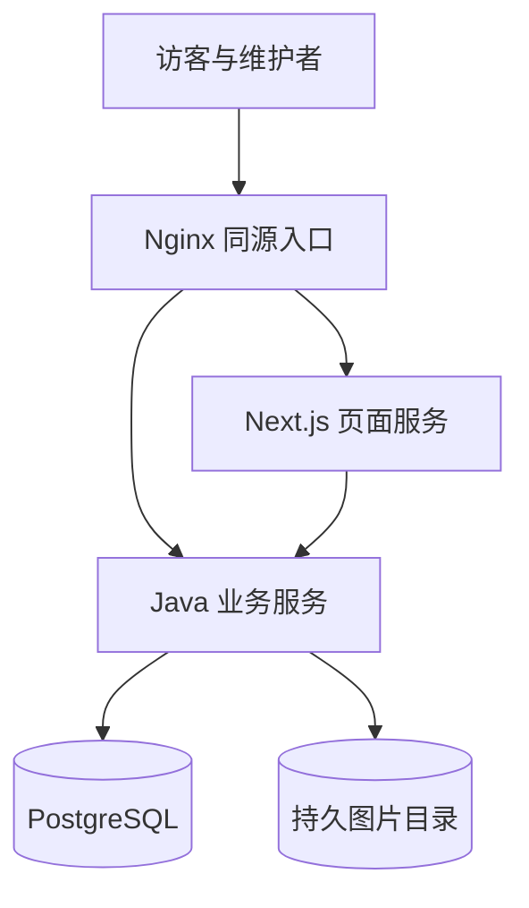

# 作品展示网站技术方案

版本 1.0 · 2026-10-27 · 小型网站方案评审稿。

需求和界面设计已由用户确认评审完成。本轮按用户回复“2”采用前后端分离、Java 后端；随后按用户“可以重启、重传解决，不要过度设计”的要求收敛方案。仅设计和评审，不创建应用或部署。

功能基线为[模块需求 v0.2](../../requirements/module-requirements-v0.2.md)与[Figma 交付说明](../../design-handoff-v1.1.md)。配套为[数据接口契约](../../architecture/data-api-contract.md)、[部署与验证](../../architecture/deployment-and-verification.md)、[方案评审记录](../../reviews/2026-10-27-technical-design-review.md)。

## 1 首期做多大

服务一个维护者，访客无需注册；中文、图片优先。公开侧四个页面模板，管理侧登录、列表、编辑、设置。首页为 H01–H09 纵向长页加局部动效。视频、支付、多账号审批、任意搭建和复杂搜索不做。

以约 100 件作品起步、1000 件作品作为后续容量检查点，数量是假设而非已经测量。优先完成浏览、编辑上传、发布下架的闭环。出现少量失败时允许维护者重传文件、刷新状态或重启服务，不为无人值守恢复另外搭一套任务系统。

必须保留登录保护、草稿与线上隔离、数据库事务、基本编辑版本检查、图片格式和体积限制，以及一份可恢复备份。这些是防止误公开和数据丢失的基本措施。

## 2 路线与选型

| 路线 | 优点 | 代价 | 本轮结论 |
| --- | --- | --- | --- |
| Next.js 一体化 | 服务少、同一种语言 | 不采用 Java 后端 | 比较项 |
| 前后端分离加 Java | 后端维护方式熟悉、业务规则集中 | 两套构建 | 本轮采用 |
| 现成内容管理系统 | 基础编辑功能现成 | 本项目布局和发布规则仍需定制 | 首期不采用 |

| 部分 | 选型 | 用途 |
| --- | --- | --- |
| 界面 | TypeScript、Next.js 16 稳定维护版、React、CSS Modules | 公开页面服务端渲染和管理界面 |
| 动效 | Motion for React 与 CSS | 首屏展开、视口内滚动效果和暂停 |
| 后端 | 受维护 OpenJDK 21、Spring Boot 4.1 稳定补丁版 | 一个业务应用，负责所有权限与数据规则 |
| 数据库 | PostgreSQL 17、Spring JDBC、Flyway | 内容、发布快照、分类、引用和迁移 |
| 登录 | Spring Security 账号密码与内存会话 | 仅一个维护者，无注册与第三方登录依赖 |
| 图片 | Java ImageIO 与 TwelveMonkeys WebP 读取插件 | 同步校验与缩图，不另开图像服务 |
| 文件 | 服务器持久目录 | 首期保存原图与显示图，定期备份到机器外 |
| 部署 | Docker Compose、Nginx、HTTPS | 一台服务器，前端、后端、数据库分容器 |

开发开始时锁定精确补丁、镜像摘要和依赖锁文件，不使用预发布或 latest 漂移版本。Java 使用维护中的 OpenJDK 发行版，不默认购买 Oracle 商业许可。若 ImageIO 对实际素材颜色或 WebP 解码支持不足，先修复该上传格式适配，不引入整套媒体平台。

## 3 结构与进程

页面由 Next.js 渲染，/api 和 /media 由 Java 处理。浏览器只访问同一域名；前后端分离不增加跨域登录问题。Java 的模块按身份、作品、媒体、配置、分类和公开查询分包，仍是一个应用，不拆微服务。

首期没有消息队列、持久任务、租约、自动重试调度、发布操作中心、Redis、对象存储签名上传、分布式会话和高可用集群。图片增多或本地磁盘维护明显困难后，再迁移对象存储；现在不为它预建平台。

## 4 保存与发布

### 4.1 保存

作品记录保存当前草稿 JSON、draftRevision 和 stateRevision。草稿允许缺业务必填值，但不能包含非法格式或未授权图片。每次保存携带期望 draftRevision，条件不符返回冲突，维护者复制当前输入后刷新处理，不自动合并。

保存成功但响应丢失，先刷新读取服务器内容和修订再决定是否重试，不做保存请求收据系统。保存失败保留当前页面输入；刷新或重启前提醒未保存内容可能丢失。

### 4.2 发布

上传成功时已生成发布所需显示图，发布不再进行图片处理。发布是一个同步数据库短事务：

1. 锁住配置单例行，再锁目标作品；检查维护者、草稿修订、状态版本和资源是否齐全。
2. 为该草稿修订建立不可变公开快照；同一修订的已有快照可复用。
3. 同事务切换公开指针、公开图片引用、可见状态和排序版本，写操作记录，提交后返回成功。

正文、封面与标题从同一个快照读取，不从草稿拼装。事务失败完整回滚，旧快照继续公开。网站配置也采用草稿与公开快照，发布作品不自动加入首页，发布首页配置不顺带发布作品。

超时只提示“结果待确认，请刷新查看”，不自动重复提交。刷新显示当前是否公开及对应草稿修订。重复点击发布同一修订且该修订仍在公开时直接返回已有结果，不生成额外版本；已经下架时，旧状态版本的重试返回冲突，不能自动重新上线。精确判断顺序见接口契约。

### 4.3 下架与回收

下架也是同步短事务，提交后才反馈成功。它增加 stateRevision，移除当前公开引用和排序位置，保留内容与文件。新公开请求不再返回它。回收只允许未公开作品；恢复回收区作品不自动上线。重新上架排在全局排序末尾，维护者可手工调整。

服务重启后不继续未完成发布，也不自动重新上线任何作品；数据库只会保留完整旧版本或完整新版本。没有必须人工清除的发布锁或后台任务。

## 5 图片上传与失败处理

每次上传一张文件，客户端队列最多 10 张、默认逐张上传；每张最多 20,000,000 字节，界面标为 20 MB；每件作品含封面去重最多 30 张。只接收 JPG、PNG、静态 WebP。上传请求由 Java 同步校验真实格式、尺寸和完整解码，保存原图并生成显示图；全部成功后才返回可绑定资源编号。

首期生成最长边不超过 480、960、1600、2560 的必要显示档位，小图不放大。JPEG 原图生成 JPEG；透明 PNG 或 WebP 生成保留透明度的 PNG 显示图。所有显示图使用统一色彩空间并清理元数据，原图不覆盖。生成全部需要的图后再把资源记为 READY。

40,000,000 像素、单边 20,000 像素是新增的输入安全上限；超限明确提示先缩图，不当作网络失败。服务器同一时刻最多处理一张图，避免同时解码多张大图耗尽内存。低于建议长边 1600 像素只提醒。

失败就重传该文件，其他成功项不动。超时后重新上传可能留下无引用副本，首期接受这点空间浪费，不做跨请求去重。取消只停止当前浏览器队列项与请求；晚到结果不插入编辑内容。上传完成和绑定草稿分开，只有随后保存的资源引用才属于作品。

封面以已保存裁剪矩形在浏览器内裁切显示，详情保留完整原比例。横幅桌面和手机各有焦点，不重新加工原图。裁剪数据基于上传时已矫正方向的图片坐标。精确显示和兼容样例见接口与验证文档。

原图和显示图在容器外的持久目录；匿名请求不能直接访问该目录。公开图片经 Java 检查当前公开引用后读取文件，管理图片必须登录。首期不做自动永久删图；未使用文件可在有备份后人工核对清理，曾发布和回收区文件先保留。

## 6 公开读取与列表

公开 HTML、JSON 和业务图片不启用共享缓存，响应 no-store；静态脚本与样式可使用哈希长缓存。没有数据库读副本。一次页面数据读取从主库读取同一完整快照，必要的组合查询放一个可重复读只读事务，避免把新旧字段拼起来。

下架成功后开始的新读取必须重新过滤。已在浏览器显示的内容无法追回，旧页面未加载且不再被公开引用的图片可能变成占位提示；不做实时推送撤回和 CDN 失效系统。

作品列表不在服务器维护浏览会话或签名游标。首次取得一个轻量的公开作品编号有序列表，保存在当前标签页；加载更多时带上这份顺序与希望显示数量，服务端按当前可见性重新过滤，返回前 12、24、36 项。站点规模小，允许重复返回少量卡片数据，换取实现直接。

这份初始编号序列保证新增与重排不会插入本次浏览；下架实时过滤且自动补足。分类使用当前分类归属重新筛选，返回全部已加载前缀，所以迁移分类也不会产生跨页重复。刷新或切换分类时重新建立顺序，切换分类将显示数量重置为 12 并回到列表起点。返回详情时恢复初始顺序、分类、希望显示数量和滚动位置，然后重新取数。详细边界在接口契约中固定。

## 7 分类和网站配置

一个作品只选一个分类，默认系统“其他”。分类改名和排序直接生效；停用不允许新增关联，但旧作品和旧首页入口仍可保留。删除采用逻辑删除，检查当前草稿、当前公开版本和当前配置引用，不能通过删除破坏线上。

全局排序保存完整公开集合并携带 catalogRevision；成员发生变化或版本过期就提示刷新重排。首页各区块内顺序独立，分类管理放设置标签页，不新增业务页面。

品牌、关于、联系与 H01–H09 配置共用一个配置草稿与公开快照。H03–H08 可关闭，顺序固定；缺内容时按原需求隐藏或降级，不保留空白高度。联系数据只有一份。

## 8 最小安全措施

维护者账号和 BCrypt 密码哈希从服务器私密配置加载，无公开注册和密码找回系统。Spring Security 提供登录校验、会话与 CSRF 防护；不自行编写加密算法。密码变更由维护者更新哈希配置并重启，重启后重新登录，这是本次明确接受的简化。

会话只保存在 Java 进程内，空闲 30 分钟失效，不做多副本共享；退出销毁会话。登录接口按来源限速，管理接口、预览和管理图片均再次检查维护者身份。Cookie 为 Secure、HttpOnly、SameSite=Lax，同源部署且只开放 HTTPS。

未发布和不存在的作品公开读取统一不可见，不泄漏草稿存在性。文字按纯文本渲染，外链只允许安全 HTTPS 地址；数据库使用参数化 SQL。图片路径全部由服务端生成，不能让请求路径直接映射任意服务器文件。

## 9 页面布局与动效

保持 Figma 的桌面 1440、内容最大 1280、左右 80；手机 390、内容 342、左右 24；平板左右 32。普通网格与分类面板分别按交付说明处理，使用弹性布局和网格，不用绝对定位复刻整张长画板。

H01 展开、H02 重排、H04 文字强调和 H06 画廊局部运动按参考实现；不劫持滚轮，不强制整屏轮播。减少动画、悬停聚焦暂停、手机手动浏览和弹层焦点控制保留。动效失败时用稳定静态布局，不让正文或导航消失。

后台输入框高 48、标签间距 8、字段间距 24。详情图完整显示，长文阅读宽度单独约束；真实品牌内容替换后按 320、390、768、1440 再检查。

## 10 部署与恢复边界

首期一台服务器，2 vCPU、4 GB 内存作为试运行起点，不是已经通过压测的容量承诺。Java 图片解码并发 1；若真实大图测试内存不足，优先降低上传处理并发或提高内存，不先拆图像平台。

每天备份数据库和持久图片目录到服务器之外，最近 7 个日备份加 4 个周备份，至少演练一次恢复。初始目标允许最多丢失 24 小时内容，恢复目标 4 小时；均待实际演练。机器故障期间允许站点暂时不可用，不声称高可用。

部署地区、域名和具体机器尚未指定，后续确认即可。当前不购买、不创建云资源。技术方案确认后再写开发执行计划和产品代码。

## 11 对原需求的简化说明

| 原需求或先前展开 | 本轮处理 | 仍保证什么 |
| --- | --- | --- |
| 发布操作编号、结果查询与自动恢复 | 改为同步事务、目标修订和刷新确认，不设操作表 | 不半发布；重复同修订不重复创建；旧请求不能推翻下架 |
| 预览指定保存版本 | 只预览当前已保存修订；修订变化时提示重新预览 | 不读取未保存内容，不把草稿公开 |
| 7 天临时资源自动清理 | 首期不自动永久删除；必要时备份后人工清理 | 不误删有效图片；接受少量无引用文件 |
| 上传取消和重试持久队列 | 仅当前浏览器队列，失败重传 | 已成功项保留，取消晚到不自动绑定 |
| 稳定分页服务端集合与游标 | 标签页编号顺序加全量已加载前缀 | 顺序稳定、下架过滤、12/12/1 和返回恢复 |
| 复杂无人值守容错 | 刷新、重传、重新登录、重启 | 保存成功的数据落数据库和持久磁盘 |

这些是根据用户本轮“不要过度设计”的指示作出的明确取舍，不能继续声称首期实现了原文全部操作编号和自动恢复能力。原需求归档不覆写，以本表记录范围收敛。

## 12 官方资料

2026-10-27 查阅：[Spring Boot 系统要求](https://docs.spring.io/spring-boot/system-requirements.html)、[Spring Security 表单登录](https://docs.spring.io/spring-security/reference/servlet/authentication/passwords/form.html)、[密码存储](https://docs.spring.io/spring-security/reference/features/authentication/password-storage.html)、[TwelveMonkeys ImageIO](https://github.com/haraldk/TwelveMonkeys)、[Next.js 自托管](https://nextjs.org/docs/app/guides/self-hosting)、[版本维护政策](https://nextjs.org/support-policy)、[PostgreSQL 事务](https://www.postgresql.org/docs/current/transaction-iso.html)、[OWASP 文件上传](https://cheatsheetseries.owasp.org/cheatsheets/File_Upload_Cheat_Sheet.html)。选型需实施时锁定补丁并用真实素材验证，本轮未安装或运行应用。
