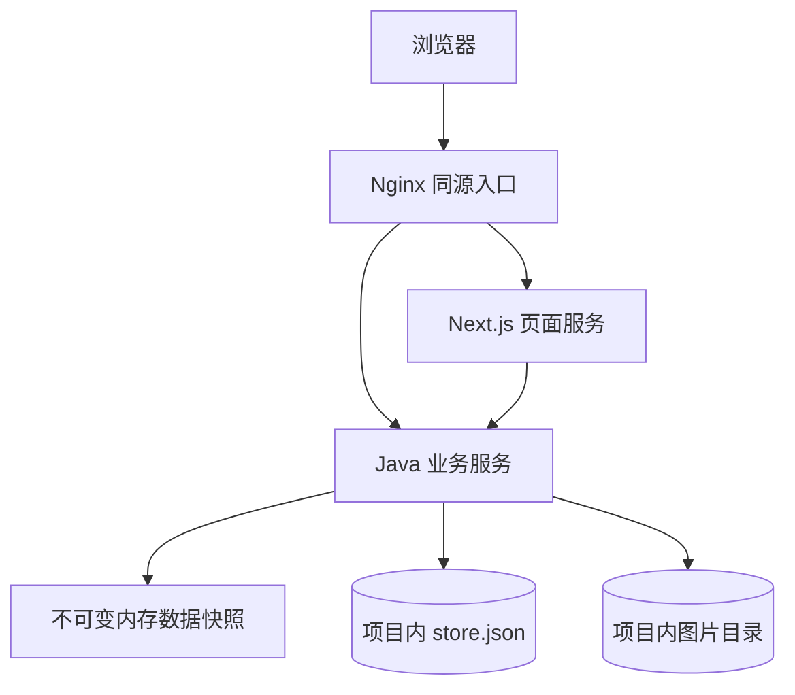

# 作品展示网站技术方案

版本 1.1 · 2026-10-27 · 本地文件存储修订。按用户本轮要求取消关系数据库，图片放项目目录，补齐数据模型、字段、首图与顺序方案。本轮只更新设计文档与评审，不开发网站。

详细字段与JSON示例见[数据模型与接口](../../architecture/data-api-contract.md)，运行方式见[部署与验证](../../architecture/deployment-and-verification.md)，结论见[评审记录](../../reviews/2026-10-27-technical-design-review.md)。界面基线仍为[Figma V1.1](../../design-handoff-v1.1.md)和[模块需求](../../requirements/module-requirements-v0.2.md)。

## 1 本轮决定

| 项目 | 采用方式 |
| --- | --- |
| 业务数据 | 项目内 storage/data/store.json 持久化，Java内存对象负责查询 |
| 图片文件 | storage/images/originals、display、tmp 三类目录 |
| 首图 | WorkContent.coverImageId 指向作品中的一个图片内容块，只有一个 |
| 内容顺序 | 图片和文字统一按 blocks[].sortOrder 排列；首图块固定首位 |
| 数据模型 | 作品、图片内容块、图片资源、分类、网站配置，共5个逻辑模型 |
| 后端进程 | 一个Java写进程，单维护者；失败刷新、重传或重启 |

本地文件比纯内存更适合保存作品：已保存内容重启仍在。内存仅用于加速读取和登录会话，不另引入内存数据库服务。当前只保留每件作品的草稿和当前公开版，完整历史版本从备份恢复。

## 2 技术组成

| 部分 | 选择及职责 |
| --- | --- |
| 前端 | TypeScript、Next.js 16稳定维护版、React、CSS Modules；公开页面服务端渲染及管理交互 |
| 动效 | Motion for React和CSS；局部运动可暂停、可减少动画 |
| 后端 | 受维护OpenJDK 21、Spring Boot 4.1稳定补丁版；统一权限、文件、内容和发布规则 |
| 序列化 | Jackson的强类型JSON读写；无SQL、ORM和数据库迁移 |
| 登录 | Spring Security单一账号密码、BCrypt哈希、进程内会话 |
| 图片 | Java ImageIO和TwelveMonkeys静态WebP读取插件，单图同步处理 |
| 部署 | 一台服务器；Nginx、页面服务、Java服务三个容器；项目storage目录挂载持久保存 |

开发开始再锁定精确补丁与依赖，不创建数据库容器、连接池、JDBC、Flyway或相关测试环境。也不加入消息队列、发布任务中心、Redis、多副本写入或自动清理平台。

## 3 数据与文件结构

页面由Next.js处理，/api和/media由Java处理，浏览器使用同一域名。Java启动读取JSON建立Map索引；每次请求捕获一份只读内存快照，解析当前公开作品、分类和站点配置。文件不是直接公开接口，不能把完整JSON发给访客。

| 逻辑模型 | 主要字段概览 | 功能 |
| --- | --- | --- |
| Work作品 | id、draftRevision、stateRevision、draft、published、visible、sortOrder | 管理维护与公开状态、作品级排序 |
| ImageBlock图片块 | id、type、sortOrder、assetId、alt、caption | 作品如何使用图片，首图由coverImageId指定 |
| Asset图片资源 | id、originalPath、displayImages、format、width、height、byteSize | 原图和显示图元数据及相对路径 |
| Category分类 | id、name、slug、sortOrder、enabled、revision | 分类维护与筛选 |
| SiteConfig站点配置 | draft、published、版本、品牌、联系、homepage九区块 | 全站内容与首页手选集合 |

字段类型、默认值、必填规则、嵌套路径和实例均在[字段文档](../../architecture/data-api-contract.md)逐项列出。账号密钥在私密配置里，运行日志为普通文件，不增加业务数据表。

## 4 一次保存如何完成

所有业务写入共用一个进程内写锁。读取不会看到正在修改的对象；写入先基于当前快照创建独立副本，检查目标版本和逻辑引用，再序列化完整新文件到同目录临时文件，刷写并原子替换store.json，最后一次替换内存引用后反馈成功。

所有业务模块放同一个JSON，是为了避免保存作品成功、另一个引用文件却没保存的多文件不一致；不为几个小文件引入事务框架。图片文件在登记Asset前已经完整落盘，业务JSON只引用成功资源。

最终磁盘必须通过同目录原子替换测试，不支持时拒绝写入，不直接清空正式文件重写。单独store.lock阻止第二个写进程启动。已有JSON损坏时保留现场并要求从备份恢复，不把网站悄悄初始化为空。

这一机制只服务单机正常保存与进程重启；极端断电和磁盘故障仍靠备份，不承诺分布式事务或零数据损失。磁盘成功替换后若进程在响应前退出，重启读取新版本，维护者刷新确认即可。

## 5 草稿、发布与下架

每件作品有draft.content与published.content两份独立内容。保存只修改draft并增加draftRevision，客户端带期望版本，两个标签页冲突返回409，不自动合并。

发布检查标题、slug、分类、首图、内容块和资源存在性。然后在一个新Store副本里复制公开内容、增加公开版本、更新visible与目录顺序，一次文件替换后成功。配置发布同理，不顺带发布引用作品。首期只保留当前公开快照，不建立无限历史版本文件。

同源修订当前仍公开时，重复发布直接返回当前结果；已经下架时必须校验stateRevision，旧请求不能重新上架。下架把visible设false并增加状态版本，保留内容与图片。回收恢复仍是未公开状态。服务重启后没有后台发布任务自动续跑。

发布或保存超时先刷新确认；失败保留原内存和正式文件；未保存输入暂在页面内存，刷新前允许复制。图片失败直接重传，接受少量无引用文件，不做跨请求去重。

## 6 首图、其他图片和排序

图片角色由作品引用决定，不在磁盘文件上打标，也不移动到封面目录。一份图片资源可以被两个作品使用，各自首图和顺序独立。

- 第一次将上传图片加入作品时创建图片块并自动作为首图。
- 首图由coverImageId唯一指定，该块必须位于blocks首位、sortOrder=1。
- “设为首图”同时更换coverImageId并把目标块移到首位，其他图文块保持相对顺序。
- 其他块拖拽或上移下移，按完整块列表统一更新sortOrder；首图保持固定首位。
- 删除首图时，确认后提升剩余第一张图片；没有图片则可保存草稿但不能发布。
- 首图来源改变时重新生成新图的居中3:4裁剪和居中焦点，不能把旧图裁剪参数套到新图。
- 首页与列表封面取首图，详情顶部完整显示首图，正文从剩余块开始，避免重复展示；放大列表按图片块顺序、不循环。

例如A首图、文字T、B、C，设C为首图后为C首图、A、文字T、B。单图作品可以发布；首图就是那一个有效图片内容块。操作只先改变草稿，保存发布后访客才看到变化。

这里有三种不同顺序：作品内部blocks.sortOrder；全站作品Work.sortOrder；首页配置workIds数组顺序。它们不能共用一个排序字段。

## 7 上传和目录

项目storage下分data、images、backups、logs；images里只有originals、display、tmp三类目录。文件名用服务端资源编号，原始上传文件名只用于管理显示。JSON保存相对路径，不存某台电脑的绝对路径。

每张最多20MB、一次队列最多10张、作品去重图片最多30张；只接收JPG、PNG和静态WebP。验证真实格式、完整解码、最大40MP与单边20000像素，低于长边1600只提示。处理并发1，先保证小站稳定；失败重传，必要时重启服务。

原图保留，显示图校正方向、转sRGB并清理元数据，按需要生成最长边480、960、1600、2560档位，小图不放大。封面裁剪按显示图坐标处理，详情保持完整原比例。透明图使用保留透明度的输出。

原图和显示图都不自动永久清理。上传完成再登记Asset，登记失败可能留下无引用目录，后续备份后人工清理即可。更换首图和排序不复制或搬动文件。

storage不放进前端public目录，不直接公开整个目录。Java按当前公开作品与配置引用检查媒体访问，管理预览必须登录。项目运行数据加入Git忽略列表，部署替换代码不覆盖storage。

## 8 浏览、配置与页面

公开读取只使用可见作品的published，不读取draft；当前Store的分类和配置在同一份内存快照内解析。首页、关于和页脚使用同一公开配置。业务HTML、JSON和媒体不启用共享缓存，减少下架失效机制；静态哈希脚本样式可长缓存。

列表采用标签页初始publicKey顺序，服务端按当前可见性筛选并返回前12、24、36项。新增和重排不插入当前序列，下架即时过滤；切换分类或刷新重取序列并重置首批，详情返回恢复原条件后重新取数。不建服务器浏览会话。

分类支持改名、排序、停用、逻辑删除；内存副本中扫描引用进行校验。系统其他分类受保护。网站配置包含品牌、关于、联系及H01–H09固定顺序，H03–H08可关闭。字段文档列出了每个区块的字段与数量上限。

界面布局继续按Figma：桌面1440、内容最大1280、左右80；手机390、内容342、左右24；平板左右32。首页长页滚动，首屏展开、文字强调和画廊局部运动可暂停，减少动画时仍可操作。不修改已评审的主要视觉方向。

## 9 登录、部署和恢复

仅一个维护者，Spring Security账号密码登录，无注册和找回平台。用户名与BCrypt哈希由私密配置提供；Cookie安全标记、CSRF、HTTPS和基本登录限速保留。会话只在内存，Java重启后重新登录。

一台服务器运行三个应用容器，取消数据库进程；项目根目录storage挂载到Java服务固定路径。2核4GB作为试运行起点，真实图像内存待测。每日备份store.json与正式图片目录到机器外，至少演练一次恢复。具体域名、服务器地区和备份目的地上线前确定。

部署和备份细节见[运行方案](../../architecture/deployment-and-verification.md)。本轮没有创建实际数据目录、安装依赖或部署。

## 10 与旧方案的差异

| 原设计 | 本轮修订 |
| --- | --- |
| PostgreSQL及9张表 | 取消；5个逻辑模型嵌在一个JSON根对象里 |
| 数据库事务、外键、索引 | 单写锁、内存副本校验、一次文件原子替换、内存Map索引 |
| 分开的引用表和审计表 | 扫描当前草稿/公开内容判断引用，普通文件日志 |
| 完整历史发布快照 | 只保留当前公开版，历史通过备份恢复 |
| 图片服务器持久目录 | 明确为项目storage/images下3类目录 |
| 封面与图片顺序未完整定义 | 唯一coverImageId、统一块sortOrder、首图固定首位 |
| 图片只描述资源字段 | 补作品/块/资源/分类/九区块配置的逐字段字典与示例 |

旧需求归档不覆写。本版技术方案明确覆盖存储和图片模型的旧说明，不再把关系表、数据库事务或发布任务当首期必做项。技术方案确认后再写开发执行计划。

## 11 技术依据

文件处理在Java 21官方API [Files](https://docs.oracle.com/en/java/javase/21/docs/api/java.base/java/nio/file/Files.html)、[StandardCopyOption](https://docs.oracle.com/en/java/javase/21/docs/api/java.base/java/nio/file/StandardCopyOption.html)、[FileChannel](https://docs.oracle.com/en/java/javase/21/docs/api/java.base/java/nio/channels/FileChannel.html)定义的能力上实现，最终文件系统支持情况必须实测。图片插件见[TwelveMonkeys](https://github.com/haraldk/TwelveMonkeys)。本轮查阅日期2026-10-27，尚未做应用级运行验证。
